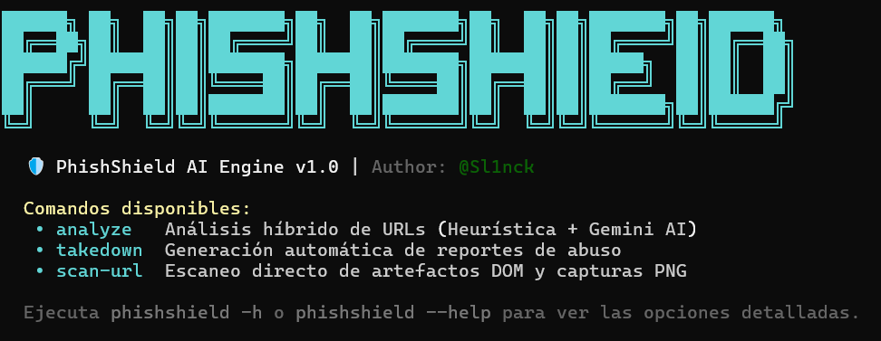

# 🛡️ PhishShield AI Engine v1.0

<p align="center">
  
</p>

> **Motor híbrido CLI de análisis de phishing impulsado por heurística estática, scraping paralelo anti-evasión e inferencia multimodal con Google Gemini AI.**

---

## 🚀 Características Principales

- **Inspección Dual Paralela (Anti-Cloaking):** Utiliza Playwright para analizar de forma simultánea el DOM y las redirecciones bajo perfiles de Escritorio y Dispositivo Móvil, detectando tácticas avanzadas de *User-Agent Cloaking* y *Smishing* evasivo.
- **Motor Heurístico Extensible:** Detecta de forma nativa patrones críticos (IPs crudas, formularios de credenciales de tipo password, iFrames sospechosos y reglas de evasión por dispositivo).
- **Inferencia Multimodal con Gemini API:** Analiza capturas de pantalla (PNG) y la estructura del DOM para identificar marcas suplantadas, lenguaje de urgencia y trampas de ingeniería social con resiliencia automática y modelos de respaldo (*fallback*).
- **Reportes Forenses Automatizados:** Generación y exportación de reportes detallados en formato JSON estructurado dentro del directorio `reports/` (con auto-pathing inteligente).
- **Generación de Cartas de Takedown:** Creación automática de notificaciones formales de abuso dirigidas a registradores y proveedores de hosting.

---

## ⚙️ Requisitos Previos

- **Python:** 3.10 o superior.
- **Node.js / Playwright:** Navegadores Chromium configurados para automatización.
- **Google Gemini API Key:** Clave de acceso configurada en tus variables de entorno (`GEMINI_API_KEY`).

---

## 📦 Instalación y Configuración

1. Clona el repositorio e ingresa al directorio del proyecto:
   ```bash
   git clone https://github.com/Sl1nck/phishshield_ai.git
   cd phishshield_ai
   ```

2. Concede permisos de ejecución al script de instalación y ejecútalo (crea el entorno virtual, instala dependencias del paquete y los binarios de Playwright):
   ```bash
   chmod +x install.sh
   ./install.sh
   ```
   *(También puedes ejecutarlo alternativamente con `bash install.sh`).*

3. Activa tu entorno virtual `.venv`:
   ```bash
   source .venv/bin/activate
   ```

4. Configura tu API Key de Google Gemini en tus variables de entorno:
   ```bash
   export GEMINI_API_KEY="tu_api_key_aqui"
   ```

5. Ejecuta `phishshield` para verificar que la instalación se realizó correctamente:
   ```bash
   phishshield
   ```

---

## ⚡ Comandos y Guía de la CLI

PhishShield AI provee una interfaz de comandos robusta estructurada de la siguiente manera:

### 1. Comando `analyze` (Pipeline Híbrido)
Analiza una URL combinando el motor heurístico estático y la inferencia condicional de la IA.

```bash
phishshield analyze "https://ejemplo-suspecto.com" --force-ai --output reporte_analisis.json
```

#### ⚙️ Opciones y Flags
* **`url`**: URL objetivo a analizar (argumento posicional obligatorio).
* **`-f, --force-ai`**: Fuerza la ejecución con Gemini AI aunque la heurística sea baja o nula.
* **`--pro`**: Utiliza el modelo avanzado de Google Gemini Pro.
* **`-o, --output <ruta>`**: Exporta un reporte forense completo en JSON con metadatos, heurísticas y dictamen de IA *(Nota: si especificas un nombre simple como `report.json`, se guardará automáticamente dentro de la carpeta `reports/`)*.

---

### 2. Comando `scan-url` (Escaneo Directo de Artefactos y Capturas)
Realiza un escaneo directo capturando la vista web en una imagen PNG y exportando los datos recopilados en JSON simultáneamente.

```bash
phishshield scan-url -u "http://127.0.0.1:8080" -s reports/evidencia.png -o reports/scan_data.json --pro
```

#### ⚙️ Opciones y Flags
* **`-u, --scan-url <url>`**: URL objetivo a escanear (obligatorio).
* **`-s, --save-screenshot <ruta>`**: Ruta de salida para almacenar la captura de pantalla en formato PNG.
* **`-o, --output <ruta>`**: Ruta de exportación del reporte JSON detallado.
* **`--pro`**: Utiliza el modelo Pro de Gemini.

---

### 3. Comando `takedown` (Generación de Cartas de Abuso)
Genera automáticamente una notificación formal de baja (*Takedown Notice*) dirigida a equipos de abuse de ISPs o registradores.

```bash
phishshield takedown "https://ejemplo-suspecto.com" --email abuse@hosting-provider.com --format markdown --output reports/takedown_notice.md
```

#### ⚙️ Opciones y Flags
* **`url`**: URL maliciosa del sitio objetivo (argumento posicional obligatorio).
* **`-e, --email <correo>`**: Correo electrónico de contacto de abuse (por defecto: `abuse@registrar-or-hosting.com`).
* **`-f, --format <formato>`**: Formato de salida de la notificación (`markdown`, `json`, `text`).
* **`-o, --output <ruta>`**: Archivo de salida donde se almacenará la carta generada.

---

## 🧭 ¿Cuándo usar `analyze` vs `scan-url`?

PhishShield v1.0 ofrece dos comandos principales de escaneo dependiendo del escenario operativo:

- **Usa `analyze` cuando:**
  - Necesitas un análisis rápido y automatizado de una URL con evaluación heurística condicional.
  - Quieres que la IA intervenga bajo demanda mediante el flag `-f / --force-ai`.
  - Tu objetivo principal es evaluar el riesgo y exportar el informe técnico en formato JSON.

- **Usa `scan-url` cuando:**
  - Estás realizando una investigación o auditoría y requieres **extraer evidencia visual física (captura de pantalla PNG)** del sitio web sospechoso.
  - Quieres realizar un escaneo directo de los artefactos DOM y guardar la captura e informe JSON simultáneamente.

---

## 🚨 Flujo de Trabajo: Respuesta a Incidentes y Envío de Takedown con Evidencia

Para lograr que un proveedor de hosting o registrador suspenda una web de phishing de forma rápida, es necesario enviar la carta formal junto con las evidencias técnicas y visuales:

### Paso 1: Recolectar evidencias (Captura PNG y Reporte JSON)
Ejecuta `scan-url` para guardar la imagen del sitio falso y la exportación de datos:
```bash
phishshield scan-url -u "https://ejemplo-suspecto.com" -s reports/evidencia_phishing.png -o reports/analisis_forense.json --pro
```

### Paso 2: Redactar la carta formal de Takedown
Genera el borrador del reporte de abuso con el comando `takedown`:
```bash
phishshield takedown "https://ejemplo-suspecto.com" --email abuse@hosting-provider.com --format markdown --output reports/takedown_notice.md
```

### Paso 3: Enviar la notificación por correo al proveedor
Envía un correo electrónico a la dirección de abuso del proveedor (`abuse@...`):
- **Asunto:** `URGENT: Phishing / Credential Harvesting Activity Hosted on Your Network - [URL]`
- **Cuerpo del correo:** Pega el texto generado en `reports/takedown_notice.md`.
- **Archivos adjuntos:**
  1. `reports/evidencia_phishing.png` *(Prueba visual).*
  2. `reports/analisis_forense.json` *(Datos técnicos y hallazgos del motor).*

---

## 🧪 Laboratorio Local de Pruebas (Anti-Cloaking)

PhishShield v1.0 incluye un servidor de pruebas en la carpeta `tests/` para simular sitios con evasión por dispositivo (*User-Agent Cloaking*):

1. En una terminal, ejecuta el servidor simulador:
   ```bash
   python tests/cloaking_lab/cloaking_server.py
   ```
2. En otra terminal, analiza la URL local:
   ```bash
   phishshield analyze "http://127.0.0.1:8080" --force-ai --output report.json
   ```

---

## 📂 Estructura del Proyecto

```text
phishshield_ai/
├──assets/                # Carpeta para imágenes, logos y banners
├── src/
│   └── phishshield/
│       ├── cli/          # Interfaz de comandos (Typer + Rich)
│       ├── core/         # Adaptadores LLM (Gemini), factorías y esquemas
│       ├── heuristics/   # Motor de reglas estáticas y detección de patrones
│       ├── scraper/      # Playwright Scraper dual (Desktop/Mobile) y Parser DOM
│       └── takedown/     # Generador de reportes de abuso y takedown
├── reports/              # Almacenamiento automático de reportes JSON y capturas PNG
├── tests/                # Laboratorio de pruebas y servidor de simulación cloaking
├── install.sh            # Script de despliegue y configuración rápida
└── pyproject.toml        # Dependencias y metadatos del paquete
```

---

## 👤 Autor
Desarrollado por **@Sl1nck**.